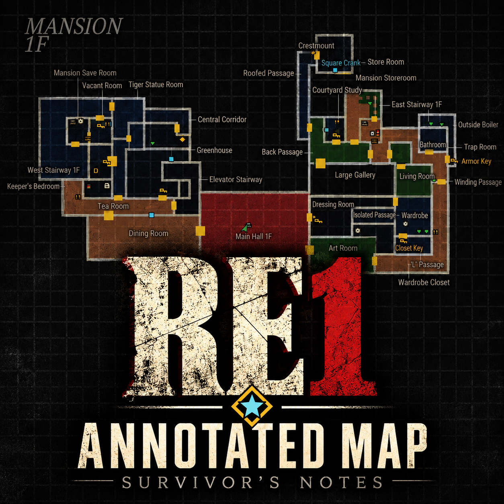
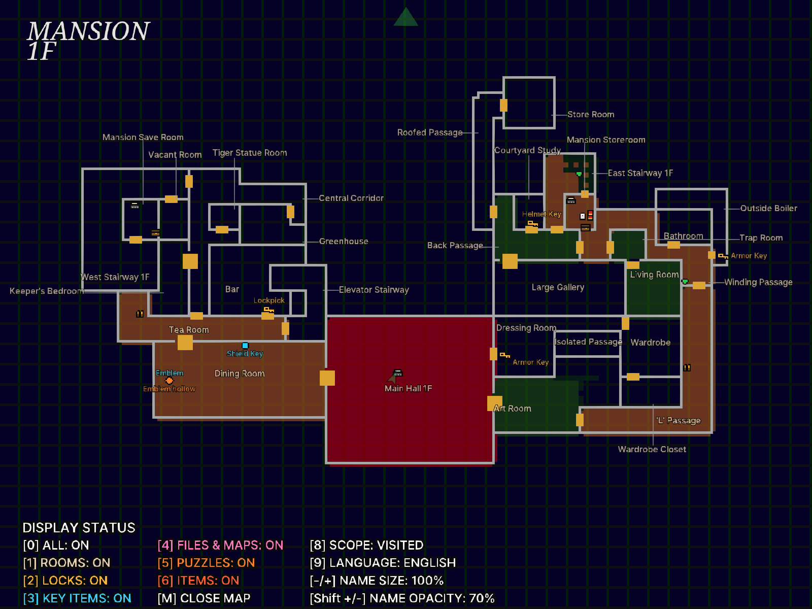
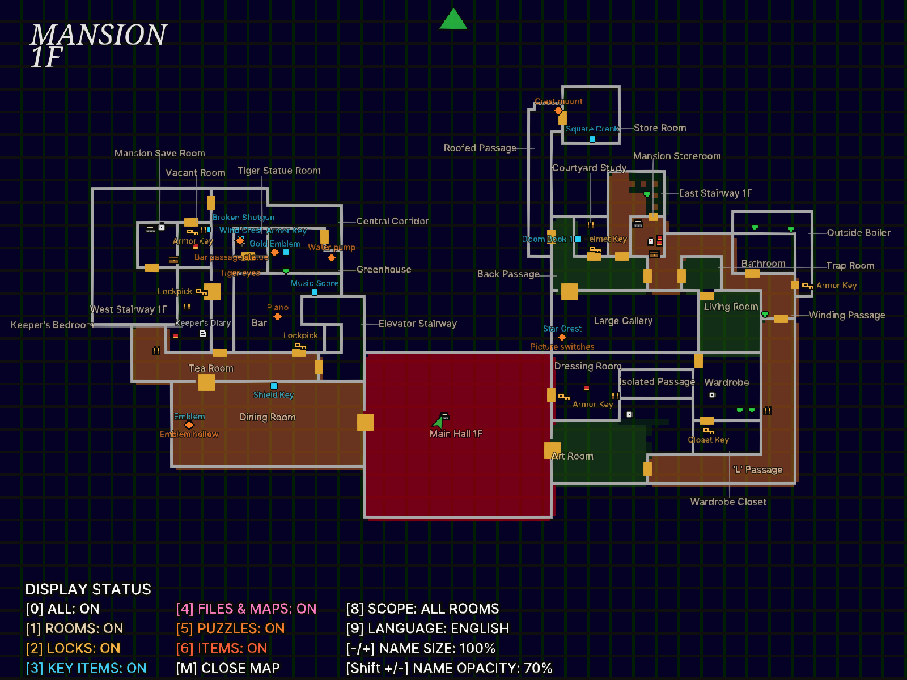
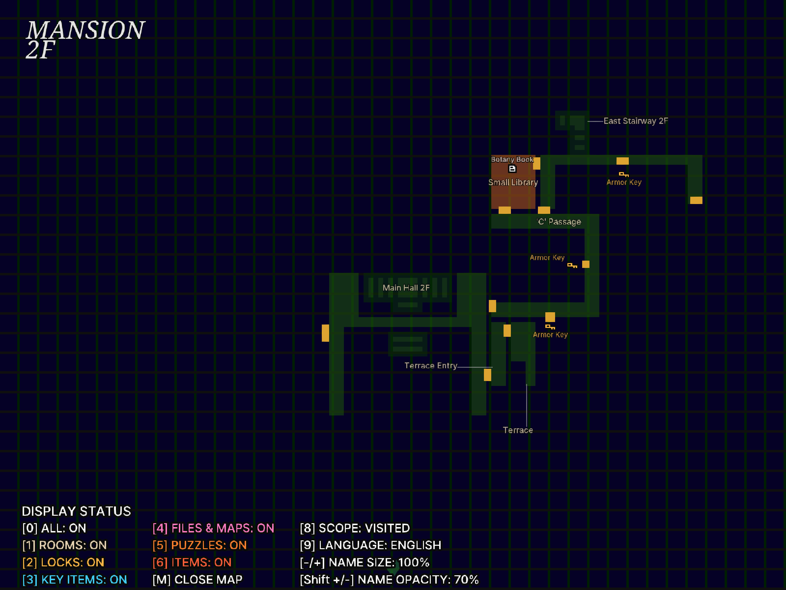
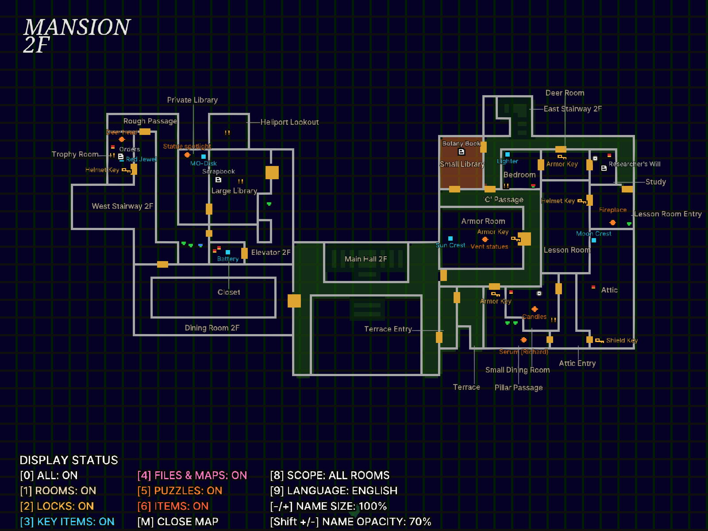
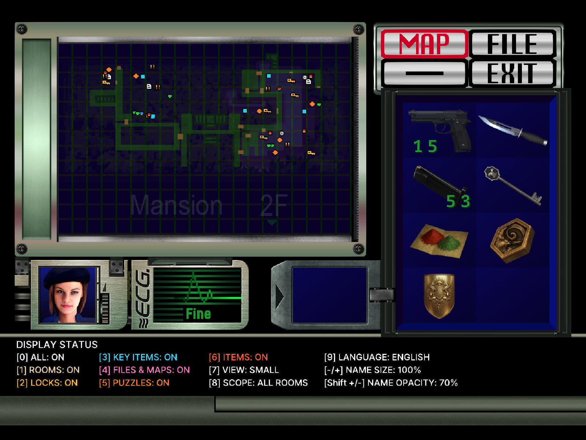

# Annotated Map: Survivor's Notes — Resident Evil (1996)

[English](README.md) | 한국어

<p align="center"></p>

**상세 지도: 생존자의 메모** — 원작 Resident Evil PC판(GOG 일본어판 `Biohazard.exe` + [Classic REbirth 1.1.3 이상](https://classicrebirth.com/index.php/re1cb-changelog/))의 지도에 방 이름, 잠긴 문과 필요한 열쇠, 핵심 아이템, 문서·지도, 퍼즐, 스토리 이벤트, 일반 아이템, 적, 타자기·아이템 상자를 표시하는 ASI 모드입니다. 한국어/영어를 지원합니다.

- 상태 화면 지도에는 아이콘만, **Tab**(패드 **START**)으로 여는 전체 화면 지도에는 방 이름과, **H**로 아이템 이름까지 표시합니다.
- 주운 아이템, 연 문, 푼 퍼즐, 이미 일어난 스토리 이벤트, 쓰러뜨린 적은 지도에서 사라집니다. 아이템이 남은 방은 호박색으로 칠합니다.
- 잠긴 문의 열쇠는 문 위에 표시합니다(`KeySide=1`이면 아직 가지 않은 쪽 방). 전체 화면 지도에는 현재 위치와 바라보는 방향을 화살표로 표시합니다.
- Classic REbirth의 HD 텍스처가 꺼져 있어도 읽기 쉬운 SD 배치로 바뀝니다([SD 모드](#sd-모드)).
- 전체 화면 지도에서 게임의 결정 키로 확대할 수 있고, 아이템·열쇠·문서·퍼즐은 HD풍 아이콘으로 표시합니다.
- 크리스/질의 아이템 배치 차이를 반영합니다.

## 스크린샷

### 전체 화면 지도

| | 방문한 방 | 모든 방 |
|---|---|---|
| 저택 1층 |  |  |
| 저택 2층 |  |  |

### 상태 화면 지도

| | 방문한 방 | 모든 방 |
|---|---|---|
| 저택 2층 |  |  |

## 설치

1. [Releases](https://github.com/eggu/resident-evil-annotated-map/releases)에서 `RE1-Annotated-Map-<버전>.zip`을 받습니다. `Source code`는 설치 파일이 아닙니다.
2. 게임을 종료하고 ZIP의 내용(`dsound.dll`, `scripts/`)을 `Biohazard.exe`가 있는 게임 폴더에 폴더 구조 그대로 복사합니다. REbirth **MOD SELECTION**에서 체크할 필요는 없습니다.
3. Classic REbirth는 별도로 설치해야 합니다. ASI 로더인 [Ultimate ASI Loader](https://github.com/ThirteenAG/Ultimate-ASI-Loader) v9.7.4(MIT)가 `dsound.dll`로 포함되어 있습니다.
   - REuncap 등으로 Ultimate ASI Loader가 이미 `dsound.dll`로 설치되어 있으면 `dsound.dll`은 건너뛰어도 됩니다.
   - ASI 로더가 아닌 다른 `dsound.dll`(예: DSOAL)이 있으면 덮어쓰지 말고, 포함된 `dsound.dll`을 `winmm.dll` 이름으로 복사하세요.

1.1.x에서 업그레이드: 게임을 종료하고 새 ZIP을 기존 파일 위에 풉니다. 기존 `scripts/RE1.AnnotatedMap.ini`는 건너뛰거나 백업 후 복원하세요. 설정은 그대로 유지되고, 처음 실행할 때 새 항목이 파일에 추가됩니다. 1.2.0에서 숫자 키 번호가 바뀌었습니다([단축키](#단축키) 참고).

1.0.x 또는 1.1.0에서 업그레이드: 먼저 게임 폴더의 `RE1.AnnotatedMap.dll`과 `mod_annotated_map/`을 지웁니다. 기존 설정을 유지하려면 `mod_annotated_map/RE1.AnnotatedMap.ini`를 `scripts/`로 옮겨 기본 INI 대신 사용하세요.

제거: `scripts/RE1.AnnotatedMap.asi`, `.ini`, `.log`를 지웁니다. 다른 ASI 모드가 없으면 `dsound.dll`도 지웁니다. EXE와 세이브는 수정하지 않습니다. 지원 대상이 아닌 `Biohazard.exe`(타임스탬프 `0x3642d468`이 아닌 경우)에서는 아무것도 패치하지 않습니다.

[한글 HD 번역 모드](https://github.com/eggu/resident-evil-korean-hd-translation)와 함께 사용할 수 있습니다.

## 단축키

| 키 | 동작 |
|---|---|
| Tab / 패드 START(Menu/Options) | 전체 화면 지도 열기·닫기 (탐색 중 조작 가능한 상태 또는 상태창 지도에서) |
| Esc / 취소 버튼 | 전체 화면 지도 닫기 |
| 앞/뒤 이동 | 층 선택 |
| 좌/우 이동 | 장소 선택 |
| 0 | 전체 표시 켜기/끄기 |
| 1 | 방 이름·타자기·아이템 상자 |
| 2 | 잠긴 문·열쇠 |
| 3 | 핵심 아이템(무기 포함) (+ 아이템이 남은 방 호박색) |
| 4 | 문서·지도 |
| 5 | 퍼즐 (주황색 `!` 마름모) |
| 6 | 이벤트: 스토리 장면(스포일러). 보라색 `?` 마름모(이름 없이 아이콘만), 장면이 일어나면 사라짐. 기본 꺼짐 |
| 7 | 일반 아이템 |
| 8 | 적 |
| 9 | 표시 범위: 방문한 방 → 공개된 방(층 지도 획득) → 모든 방 |
| `\`(₩) | 한국어 / English (한국어 키보드에서는 `₩`로 표시되는 키) |
| H | 전체 화면 지도의 아이템 이름 켜기/끄기 |
| - · = (+), 숫자패드 - · + | 이름 크기 10%씩 (50–150%) |
| [ · ] | 이름 불투명도 10%씩 (10–100%) |
| Shift + - · = (+) | 아이콘 크기 10%씩 (50–200%) |
| Shift + [ · ] | 아이콘 불투명도 10%씩 (10–100%) |
| ~ (1 왼쪽 키) | 범례를 한 줄로 접기/펴기 |
| 결정·조사 키 (전체 화면 지도) | 1배/2배 확대. 확대 중에는 게임의 지도 방향 입력으로 이동 |
| F12 | 버그 제보용 디버그 기록 저장 (`scripts/RE1.AnnotatedMap.capture.txt`) |

`[Keys] Modifier=CTRL`로 Shift 대신 Ctrl을 쓸 수 있습니다. 1.1.2까지는 `6` 일반 아이템, `8` 표시 범위, `9` 언어였고 Shift + - · +가 이름 불투명도였습니다. 지금은 `\`가 언어 전환, Shift + - · +가 아이콘 크기, 이름 불투명도는 [ · ]입니다. 저장된 값은 그대로 유지됩니다.

## 설정 (`scripts/RE1.AnnotatedMap.ini`)

배포 ZIP에 설명 주석이 담긴 기본 설정 파일을 포함합니다. 편집 전 게임을 종료하고, 저장 후 게임을 다시 실행하세요.

### 패드 지도 버튼 변경

START를 게임 동작에 연결해 두었다면 `[Keys]`의 `OpenPad=START`를 사용하지 않는 버튼으로 바꾸세요. Classic REbirth는 기본으로 BACK에 설정 화면을 둡니다. 예를 들어 왼쪽 스틱 클릭은 다음과 같습니다.

```ini
[Keys]
OpenPad=LS
```

지원 버튼은 아래 표에 있습니다. LT/RT 트리거와 버튼 조합은 지원하지 않으며, 게임 자체의 패드 설정과 별도로 동작합니다. `OpenPad=NONE`으로 설정하면 패드 지도 단축키를 끄고 키보드 `OpenKey=TAB`으로 사용할 수 있습니다. 이 설정은 기존 1.1.0에서도 사용할 수 있습니다. INI에 `[Keys]`가 없다면 위 예시를 추가하고, 저장한 뒤 재실행하세요.

### 표시·키 설정

표시 옵션과 이름 크기·불투명도를 저장합니다. 기본값은 **영어, 이름 100%, 불투명도 70%, 아이템 이름 끔, 아이콘 100%·불투명도 80%, 방 표시만 켬**입니다. `All`은 방 표시를 위한 전체 스위치로 켜집니다. 업그레이드할 때 기존 INI를 보존해야 사용자 설정을 유지할 수 있습니다. 일반 키보드에서는 Shift 없이 `= (+)` 키로 이름 크기를 키우세요.

두 지도 화면은 같은 범례 문구와 상태를 표시합니다. 상태 화면 지도의 범례는 HUD 아래 빈 영역에 있습니다.

| 항목 | 기본값 | 설명 |
|---|---|---|
| `[Keys] OpenKey` | `TAB` | 키보드로 열기·닫기. 한 글자, `ESC`, `TAB`, `SPACE`, `F1`–`F12`, `0x4D` 같은 가상 키 코드, `NONE` |
| `[Keys] OpenPad` | `START` | 패드로 열기·닫기(XInput). `A B X Y LB RB START BACK LS RS UP DOWN LEFT RIGHT`, `NONE` |
| `[Keys] CloseKey` | `ESC` | 키보드로 닫기 |
| `[Keys] CloseOnCancel` | `1` | 게임의 취소 버튼으로 닫기 |
| `[Keys] Modifier` | `SHIFT` | 이름 대신 아이콘을 바꿀 때 누르는 키: `SHIFT` 또는 `CTRL` |
| `[Keys] CaptureKey` | `F12` | 디버그 기록 키(`OpenKey`와 같은 이름), `NONE` |
| `[AnnotatedMap] DisplayMode` | `Auto` | `Auto`는 REbirth HD 텍스처가 꺼져 있으면(`HDLoader=0` 또는 없음, `RetroMode=1`) SD 모드, 아니면 HD 모드. `HD`/`SD`로 고정. 게임 시작 때 한 번 결정 |
| `[AnnotatedMap] RoomTint` | `1` | `0`이면 아이템이 남은 방 색칠 끄기 |
| `[AnnotatedMap] NameSize` | `100` | 이름 크기(50–150), 기존 크기가100 |
| `[AnnotatedMap] NameOpacity` | `70` | 이름 불투명도(10–100) |
| `[AnnotatedMap] ItemNames` | `0` | 전체 화면 지도의 아이템 이름: `0` 끔, `1` 모두, `2` 일반 아이템 제외(RE1 HD·RE2·RE3 모드와 같은 값). `H`로 모두 → 일반 제외 → 끔 순환. |
| `[AnnotatedMap] IconSize` | `100` | 아이콘 크기(50–200) |
| `[AnnotatedMap] IconOpacity` | `80` | 아이콘 불투명도(10–100) |
| `[AnnotatedMap] Legend` | `1` | `0`이면 범례를 한 줄로 접음(`~`) |
| `[AnnotatedMap] HdIcons` | `1` | `0`이면 전체 화면 지도도 도트 아이콘 사용(상태 화면 지도는 항상 도트) |
| `[AnnotatedMap] UploadBudget` | `12` | 지도를 열 때 프레임당 올리는 텍스처 수(1–200). 낮을수록 부드럽고 높을수록 빨리 모두 나타남 |
| `[AnnotatedMap] KeySide` | `0` | 잠긴 문의 열쇠: `0` 문 위, `1` 문 옆 아직 가지 않은 쪽 방 |
| `[Calibration] OffsetX/OffsetY/Z` | | 상태창 지도 표시 위치·깊이 보정 |
| `[Calibration] ArrowRotation` | `0` | 캐릭터 화살표 방향 보정(도) |

버전별 변경 내역: [CHANGELOG](CHANGELOG.md).

### 분류별 색 (`[Colors]`)

범례 줄·이름의 색을 INI의 `[Colors]`에서 분류마다 `#RRGGBB`로 바꿀 수 있습니다(`Rooms`, `Locks`, `KeyItems`, `Files`, `Puzzles`, `Events`, `CommonItems`, `Enemies`). 기본값은 INI에 적혀 있고, 줄을 지우면 기본색을 씁니다. 화면에는 채널당 5비트로 표시되므로 값이 최대 4/255 정도 달라 보일 수 있고, 순수 검정(`#000000`)은 게임이 투명으로 취급해 거의 검정으로 대신 표시합니다. 꺼진 줄은 짙은 회색(`#6A6A6A`)으로 고정입니다. 게임 안에서 설정을 저장해도 `[Colors]`와 주석은 그대로 남습니다. 일반 아이템 기본색은 차가운 회색(`#B8BCC4`)입니다.

### 확대와 아이콘

전체 화면 지도에서 게임의 **결정(확인·조사) 키**로 1배/2배 확대를 전환합니다(키보드·패드 모두 게임 설정의 결정 키를 그대로 따르므로 게임 `config.ini`의 `Key_Def`·패드 설정을 바꾸면 함께 바뀝니다). 확대 중에는 게임의 지도 방향 입력으로 지도를 이동하며(누르고 있으면 계속 이동), 층·구역을 바꾸려면 결정 키로 축소합니다. 이동은 지도 가장자리를 화면 1/4만큼 넘어갈 수 있습니다. 지도는 열 때마다 1배로 시작하며 확대 상태는 저장하지 않습니다. 화면 가장자리에 걸쳐 잘리는 이름·아이콘은 표식째로 숨깁니다. 범례 오른쪽의 작고 흐린 글씨는 조절 키 안내입니다.

전체 화면 지도는 아이템·열쇠·문서·퍼즐·타자기·아이템 상자·적에 HD풍 아이콘을 쓰고, 상태 화면 지도는 기존 도트 아이콘을 씁니다.

### SD 모드

Classic REbirth의 HD 텍스처가 꺼져 있으면(게임 `config.ini`에서 `HDLoader=0`이거나 없음, 또는 `RetroMode=1`) 원래 해상도로 그립니다. 9×9 픽셀 표식(퍼즐 주황 `!`, 이벤트 보라 `?`, 핵심 아이템 하늘색 원, 허브·탄약·스프레이·리본·문서·지도·타자기·아이템 상자, 적은 작은 빨간 십자, 잠긴 문은 열쇠마다 색과 무늬가 다른 자물쇠), 방 바깥에 가느다란 지시선으로 연결한 픽셀 글꼴 방 이름, 간결한 범례가 표시됩니다. 모드는 게임을 시작할 때 한 번 정해지므로 REbirth의 HD 설정을 바꾼 뒤에는 게임을 다시 시작하거나 `DisplayMode`를 직접 지정하세요. 이름·아이콘 크기, 불투명도, 아이템 이름은 SD 모드에서 적용되지 않고, 나머지 키와 확대, 언어는 그대로 동작합니다. 방 이름은 지도에 고정되어 지도와 함께 움직이며, 확대한 지도에서는 방 안에 들어가면 방 안에 표시합니다. 방이 많은 저택 1층·2층은 확대했을 때만 방 이름을 표시합니다.

### 알려진 제한

- 이름과 아이콘을 키우면 기존 위치를 유지하므로 서로 겹칠 수 있습니다. 필요하면 크기를 줄이세요.
- 적 표식은 방에 들어갈 때 배치되는 위치이며 움직임은 따라가지 않습니다. 저택 재방문 때의 적은 재방문한 저택에 있을 때만 표시합니다.
- 이벤트 표식은 게임 스크립트에서 분명하게 확인되는 장면만 포함합니다.
- `DisplayMode=HD`는 REbirth의 HD 텍스처가 필요합니다. `HDLoader=0` 또는 `RetroMode=1`이면 지도에 짧은 영어 안내문만 표시됩니다. 이 경우 `DisplayMode=Auto`로 두면 SD 모드가 됩니다.

## 빌드


```sh
python3 -m venv .venv && .venv/bin/pip install -r requirements.txt
export RE1_GAME_DIR="/path/to/Resident Evil"   # Biohazard.exe와 jpn/이 있는 GOG 일본어판 폴더
.venv/bin/python build.py --package           # 위키 → 에셋 → DLL → 네이티브 테스트 → dist/ ZIP
```

글꼴 옵션을 생략하면 포함된 오픈소스 글꼴을 사용합니다: 본문 Pretendard, 영문 제목 Noto Serif, 한글 제목 나눔명조. 빌드할 때 각 글꼴을 바꿀 수 있습니다.

```sh
.venv/bin/python build.py --package --font "/path/to/body.ttf" \
  --title-font-en "/path/to/title-en.ttf" --title-font-ko "/path/to/title-ko.ttf"
```

필요한 옵션만 지정하면 나머지는 기본값을 사용합니다. 한글에는 한글 글리프를 포함한 글꼴을 선택하세요. 글꼴은 빌드 시 이미지로 만들어지므로 변경 후 다시 빌드해야 합니다. 잘못된 경로나 읽을 수 없는 글꼴은 빌드를 중단합니다. 사용자 지정 글꼴을 배포할 때는 해당 라이선스를 확인하세요.

- 데이터를 다시 추출하려면 `--extract`를 붙입니다. 이때는 모든 `ROOM*.RDT`와 `refs/evilresource/pages/*.html`([evilresource.com/resident-evil](https://www.evilresource.com/resident-evil) 방 페이지)이 필요합니다. 참고 자료: [RE1-Mod-SDK](https://github.com/Gemini-Loboto3/RE1-Mod-SDK), [biorand/classic](https://github.com/biorand/classic), [biorand/biohazard-utils](https://github.com/biorand/biohazard-utils).
- 손으로 관리하는 데이터는 `data/curated.json`(퍼즐, 이벤트 아이템, 방 이름 보정)과 `data/items.json`(아이템 이름)입니다.
- `tests/test_native.py`는 실제 EXE와 빌드한 DLL을 Unicorn으로 실행해 패치, 플래그 판정, 지도 입력, 그리기 명령을 확인합니다. `tools/audit_fit.py`는 방별 월드→지도 변환을 점검합니다.

조사 자료와 구현 근거는 [위키](docs/wiki/README.md)에 있습니다.

## 다른 지도 모드

- [RE2 Annotated Map - Survivor's Notes](https://github.com/eggu/resident-evil-2-annotated-map) — 바이오하자드 2 (1998)
- [RE3 Annotated Map - Survivor's Notes](https://github.com/eggu/resident-evil-3-annotated-map) — 바이오하자드 3 (1999)

## 라이선스

소스는 [MIT License](LICENSE)입니다. 비공식 팬 모드이며 Capcom 및 Classic REbirth와 관련이 없습니다. 참고 자료와 글꼴 라이선스는 [NOTICE](NOTICE.md)에 있습니다.
