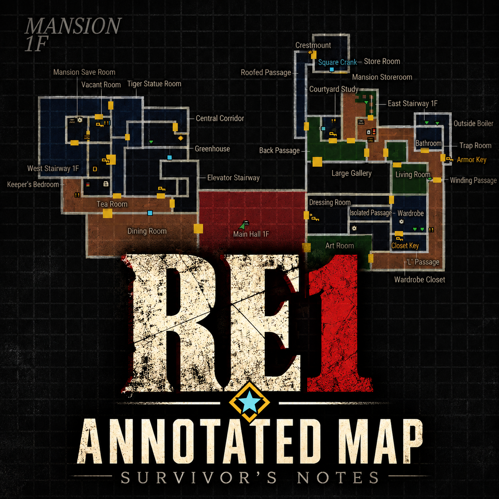
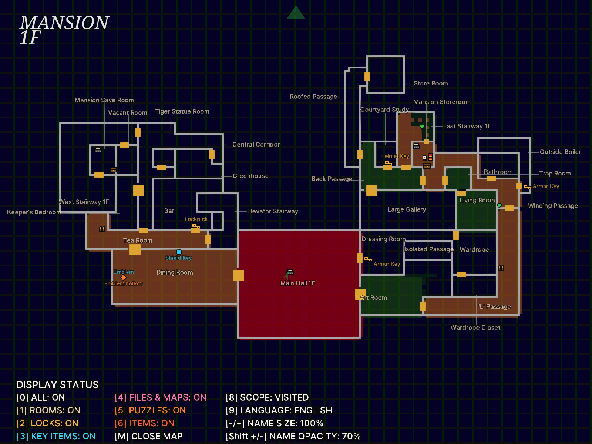
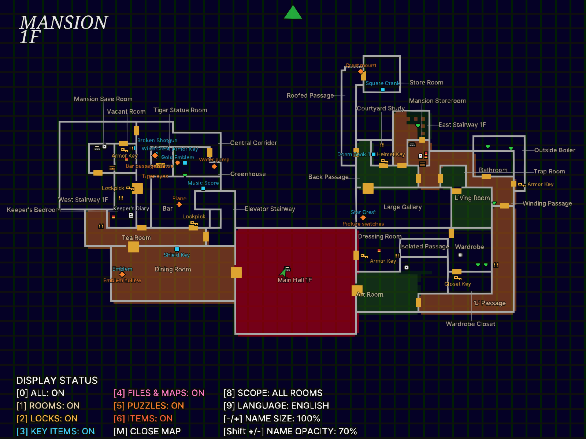
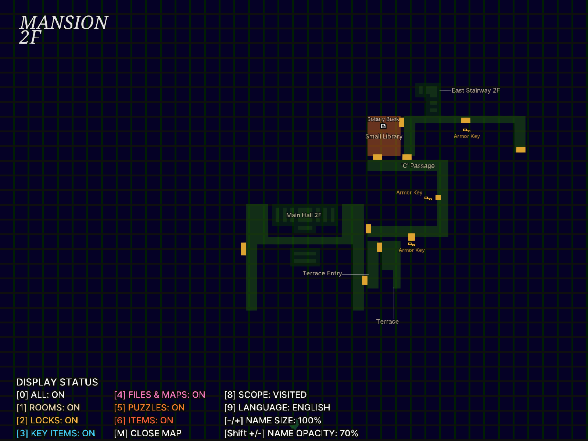
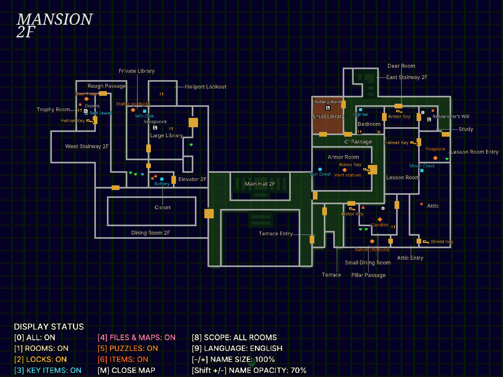
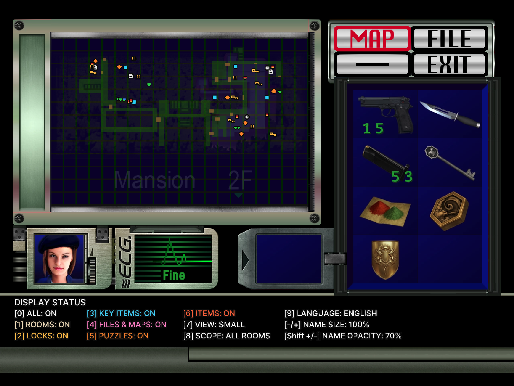

# Annotated Map: Survivor's Notes — Resident Evil (1996)

English | [한국어](README.ko.md)

<p align="center"></p>

A bilingual ASI map mod for the original Resident Evil PC release (GOG Japanese `Biohazard.exe` with [Classic REbirth 1.1.3 or later](https://classicrebirth.com/index.php/re1cb-changelog/)). Shows room names, locked doors and required keys, key items, documents and maps, puzzles, story events, common items, enemies, typewriters and item boxes.

- The status-screen map shows icons; the full-screen map opened with **Tab** (controller **START**) also shows room names, and item names with **H**.
- Collected items, unlocked doors, solved puzzles, story events that have happened and killed enemies disappear. Rooms with remaining items are tinted amber.
- Required keys appear on locked doors (or, with `KeySide=1`, on the unvisited side). The full-screen map shows your position and facing direction.
- On the full-screen map, press the game's confirm key to zoom in; items, keys, documents and puzzles use HD-style icons.
- Supports Chris and Jill item placements, with Korean and English labels.
- Works with Classic REbirth's HD textures on or off: with HD textures off (`HDLoader=0`, or `RetroMode=1`) the map switches to a readable SD layout (see [SD mode](#sd-mode)).

## Screenshots

### Full-screen map

| | Visited rooms | All rooms |
|---|---|---|
| Mansion 1F |  |  |
| Mansion 2F |  |  |

### Status-screen map

| | Visited rooms | All rooms |
|---|---|---|
| Mansion 2F |  |  |

## Installation

1. Download `RE1-Annotated-Map-<version>.zip` from [Releases](https://github.com/eggu/resident-evil-annotated-map/releases). The `Source code` archives are not installable packages.
2. Close the game and copy the ZIP contents (`dsound.dll`, `scripts/`) into the folder containing `Biohazard.exe`, preserving the directory structure. No REbirth **MOD SELECTION** step is needed.
3. Classic REbirth must be installed separately. [Ultimate ASI Loader](https://github.com/ThirteenAG/Ultimate-ASI-Loader) v9.7.4 (MIT) is included as `dsound.dll`.
   - If Ultimate ASI Loader is already installed as `dsound.dll` (for example by REuncap), you can skip `dsound.dll`.
   - If a different `dsound.dll` (such as DSOAL) is present, do not overwrite it; copy the included `dsound.dll` as `winmm.dll` instead.

Upgrading from 1.1.x: close the game and extract the new ZIP over the old files. Keep your existing `scripts/RE1.AnnotatedMap.ini` (skip it when extracting, or back it up and restore it); your settings are kept and the file gains the new entries the first time you play. The number keys were renumbered in 1.2.0 (see [Controls](#controls)).

Upgrading from 1.0.x or 1.1.0: first delete `RE1.AnnotatedMap.dll` and `mod_annotated_map/` from the game folder. To keep your settings, move `mod_annotated_map/RE1.AnnotatedMap.ini` into `scripts/` in place of the default INI.

To uninstall, delete `scripts/RE1.AnnotatedMap.asi`, `.ini` and `.log`, and `dsound.dll` if no other ASI mod uses it. The mod does not modify the EXE or saves. Unsupported executables (timestamp other than `0x3642d468`) are left unpatched.

Compatible with the [Korean HD translation mod](https://github.com/eggu/resident-evil-korean-hd-translation).

## Controls

| Key | Action |
|---|---|
| Tab / controller START (Menu/Options) | Open or close the full-screen map while exploring and able to control the character, or from the status-screen map |
| Esc / cancel button | Close the full-screen map |
| Move forward/backward | Select floor |
| Move left/right | Select area |
| 0 | Toggle all annotations |
| 1 | Room names, typewriters, item boxes |
| 2 | Locked doors and keys |
| 3 | Key items (weapons included) (+ rooms with items left tinted amber) |
| 4 | Files and maps |
| 5 | Puzzles (orange `!` diamond) |
| 6 | Events: story scenes (spoilers). Purple `?` diamond (icon only, no name), hidden once the scene has happened. Off by default |
| 7 | Common items |
| 8 | Enemies |
| 9 | Cycle visibility: visited rooms → revealed rooms (floor map acquired) → all rooms |
| `\` (₩) | Switch Korean / English (the key Korean keyboards label `₩`) |
| H | Item names on the full-screen map on/off |
| - · = (+), numpad - · + | Name size in 10% steps (50–150%) |
| [ · ] | Name opacity in 10% steps (10–100%) |
| Shift + - · = (+) | Icon size in 10% steps (50–200%) |
| Shift + [ · ] | Icon opacity in 10% steps (10–100%) |
| ~ (left of 1) | Fold the legend to one line, or show it again |
| Confirm / examine key (full-screen map) | Zoom 1x / 2x; the game's map directions pan while zoomed |
| F12 | Write a debug capture (`scripts/RE1.AnnotatedMap.capture.txt`) for bug reports |

Shift can be changed to Ctrl with `[Keys] Modifier=CTRL`. In 1.1.2 and earlier the number keys were `6` common items, `8` visibility and `9` language, and Shift + - · + changed name opacity; now `\` switches the language, Shift + - · + changes icon size and name opacity uses [ · ]. Your saved values are kept.

## Settings (`scripts/RE1.AnnotatedMap.ini`)

The archive includes a commented default configuration; the mod also creates display preferences if the file is missing. Close the game before editing the INI, then save and restart.

### Change the controller map button

Classic REbirth opens its settings screen with BACK by default. If START is bound to a game action, edit `scripts/RE1.AnnotatedMap.ini` and change `OpenPad=START` under `[Keys]` to an unused button, for example:

```ini
[Keys]
OpenPad=LS
```

`LS` means clicking the left stick. Other supported values are listed below; LT/RT triggers and button combinations are not supported. This setting is independent of the game's controller bindings. Set `OpenPad=NONE` to disable the controller shortcut and use `OpenKey=TAB` on the keyboard instead. These options already work in version 1.1.0; if your INI has no `[Keys]` section, add the example above. Save the file and restart the game.

### Display and key settings

Defaults: **English, name size 100%, opacity 70%, item names off, icon size 100%, icon opacity 80%, Rooms on, other categories off**. All remains enabled as the master switch. Keep your existing INI when upgrading to preserve its values. On the main keyboard, use the equal/plus key without Shift to increase name size.

Both map views show the same legend wording and current state. The status-screen legend sits in the empty band below the HUD.

| Setting | Default | Description |
|---|---|---|
| `[Keys] OpenKey` | `TAB` | Keyboard toggle: one character, `ESC`, `TAB`, `SPACE`, `F1`–`F12`, a virtual key code such as `0x4D`, or `NONE` |
| `[Keys] OpenPad` | `START` | XInput toggle: `A B X Y LB RB START BACK LS RS UP DOWN LEFT RIGHT`, or `NONE` |
| `[Keys] CloseKey` | `ESC` | Keyboard close key |
| `[Keys] CloseOnCancel` | `1` | Close with the game's cancel button |
| `[Keys] Modifier` | `SHIFT` | Key held to change icons instead of names: `SHIFT` or `CTRL` |
| `[Keys] CaptureKey` | `F12` | Debug capture key (same names as `OpenKey`), or `NONE` |
| `[AnnotatedMap] DisplayMode` | `Auto` | `Auto` uses SD mode when REbirth's HD textures are off (`HDLoader=0` or missing, or `RetroMode=1`) and HD mode otherwise; `HD` or `SD` forces one. Chosen once at game start |
| `[AnnotatedMap] RoomTint` | `1` | Set to `0` to disable tinting rooms with remaining items |
| `[AnnotatedMap] NameSize` | `100` | Name size (50–150); 100 is the original size |
| `[AnnotatedMap] NameOpacity` | `70` | Label opacity (10–100) |
| `[AnnotatedMap] ItemNames` | `0` | Item names on the full-screen map: `0` off, `1` all, `2` all except common items (same values as the RE1 HD / RE2 / RE3 map mods). `H` cycles all → all except common → off |
| `[AnnotatedMap] IconSize` | `100` | Icon size (50–200) |
| `[AnnotatedMap] IconOpacity` | `80` | Icon opacity (10–100) |
| `[AnnotatedMap] Legend` | `1` | `0` folds the legend to one line (`~`) |
| `[AnnotatedMap] HdIcons` | `1` | `0` uses pixel icons on the full-screen map too (the status-screen map always uses pixel icons) |
| `[AnnotatedMap] UploadBudget` | `12` | Textures loaded per frame when the map opens (1–200); lower is smoother, higher shows everything sooner |
| `[AnnotatedMap] KeySide` | `0` | Locked-door keys: `0` on the door, `1` beside the door in the room not visited yet |
| `[Calibration] OffsetX/OffsetY/Z` | | Status-screen annotation position and depth correction |
| `[Calibration] ArrowRotation` | `0` | Character arrow rotation correction in degrees |

Version history: [CHANGELOG](CHANGELOG.md).

### Category colours (`[Colors]`)

The legend row and name colour of every category can be set in the INI's `[Colors]` section as `#RRGGBB` (`Rooms`, `Locks`, `KeyItems`, `Files`, `Puzzles`, `Events`, `CommonItems`, `Enemies`). The defaults are written in the INI; delete a line to use the default. The screen shows 5 bits per channel, so a value can look up to about 4/255 different, and pure black (`#000000`) is treated as transparent by the game, so it is shown as near-black instead. Disabled legend rows are a fixed dark grey (`#6A6A6A`). Saving settings in game keeps `[Colors]` and your comments. Common items default to a cool grey (`#B8BCC4`).

### Zoom and icons

On the full-screen map, the game's own **confirm / examine key** toggles 1x/2x zoom (keyboard and controller follow the game's bindings, so changing `Key_Def` or the pad mapping in the game's `config.ini` changes it too). While zoomed, the game's map directions pan the map (hold to keep moving); press confirm again to zoom out before changing floor or area. Panning can go a quarter of the screen past each map edge. The map always opens at 1x; the zoom level is not saved. A name or icon that a screen edge would cut off is hidden together with its marker. The small dim text to the right of the legend lists the adjustment keys.

The full-screen map uses HD-style icons for items, keys, documents, puzzles, typewriters, item boxes and enemies; the status-screen map keeps the pixel icons.

### SD mode

With Classic REbirth's HD textures off (`HDLoader=0` or missing, or `RetroMode=1` in the game's `config.ini`) the mod draws at the game's original resolution: 9×9 pixel markers (7×7 on the status-screen map; puzzles amber `!`, events purple `?`, key items cyan circle, herbs, ammo, spray, ribbon, files, maps, typewriters, item boxes; enemies are small red crosses; each locked door shows a padlock coloured and patterned for its key), room names in a pixel font that sit outside their room on a thin leader line, and a compact legend. The mode is chosen once when the game starts; restart the game after changing REbirth's HD setting, or set `DisplayMode` yourself. Name and icon size, opacity and item names do not apply in SD mode; the other keys, zoom and language work as usual. Room names are fixed on the map and scroll with it; on the zoomed map a name goes inside its room when it fits. On Mansion 1F and 2F, which have many rooms, names appear only on the zoomed map.

### Known limitations

- Larger names and icons keep their anchor positions and may overlap; reduce the size if needed.
- Enemy markers show where enemies are placed when a room loads, not where they move. Enemies of the mansion revisit are shown only while you are in the revisited mansion.
- Event markers include only scenes that the game scripts identify clearly.
- `DisplayMode=HD` needs REbirth's HD textures: with `HDLoader=0` or `RetroMode=1` the map then shows a short English notice instead. Leave `DisplayMode=Auto` to get SD mode there.

## Build

```sh
python3 -m venv .venv && .venv/bin/pip install -r requirements.txt
export RE1_GAME_DIR="/path/to/Resident Evil"   # GOG Japanese game folder containing Biohazard.exe and jpn/
.venv/bin/python build.py --package           # wiki → assets → DLL → native tests → dist/ ZIP
```

Omitting font options uses the bundled open-source fonts: Pretendard for body text, Noto Serif for the English title, and Nanum Myeongjo for the Korean title. Override any of them at build time:

```sh
.venv/bin/python build.py --package --font "/path/to/body.ttf" \
  --title-font-en "/path/to/title-en.ttf" --title-font-ko "/path/to/title-ko.ttf"
```

Unspecified options retain their defaults. Choose fonts with Korean glyphs for Korean text. Fonts are rasterized during the build, so changing them requires rebuilding. Invalid paths or unreadable fonts stop the build. Check custom font licenses before distributing a build.

- Add `--extract` to regenerate data. This requires all `ROOM*.RDT` files and `refs/evilresource/pages/*.html` ([evilresource.com/resident-evil](https://www.evilresource.com/resident-evil) room pages). References: [RE1-Mod-SDK](https://github.com/Gemini-Loboto3/RE1-Mod-SDK), [biorand/classic](https://github.com/biorand/classic), [biorand/biohazard-utils](https://github.com/biorand/biohazard-utils).
- Manually maintained data lives in `data/curated.json` (puzzles, event items and room-name corrections) and `data/items.json` (item names).
- `tests/test_native.py` runs the real EXE and built DLL in Unicorn to check patches, flag conditions, map input and drawing commands. `tools/audit_fit.py` checks room world-to-map transforms.

Research and implementation notes are available in the [wiki](docs/wiki/README.md).

## Other map mods

- [RE2 Annotated Map - Survivor's Notes](https://github.com/eggu/resident-evil-2-annotated-map) — Resident Evil 2 (1998)
- [RE3 Annotated Map - Survivor's Notes](https://github.com/eggu/resident-evil-3-annotated-map) — Resident Evil 3: Nemesis (1999)

## License

Source code is licensed under the [MIT License](LICENSE). This is an unofficial fan mod, unaffiliated with Capcom or Classic REbirth. See [NOTICE](NOTICE.md) for references and font licenses.
