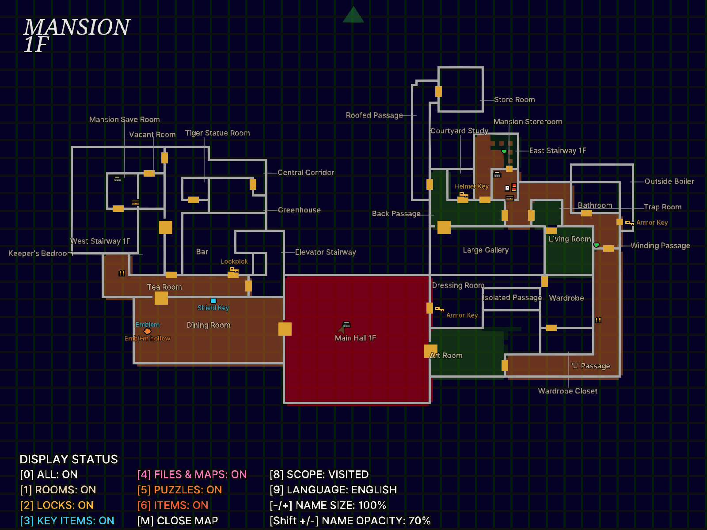
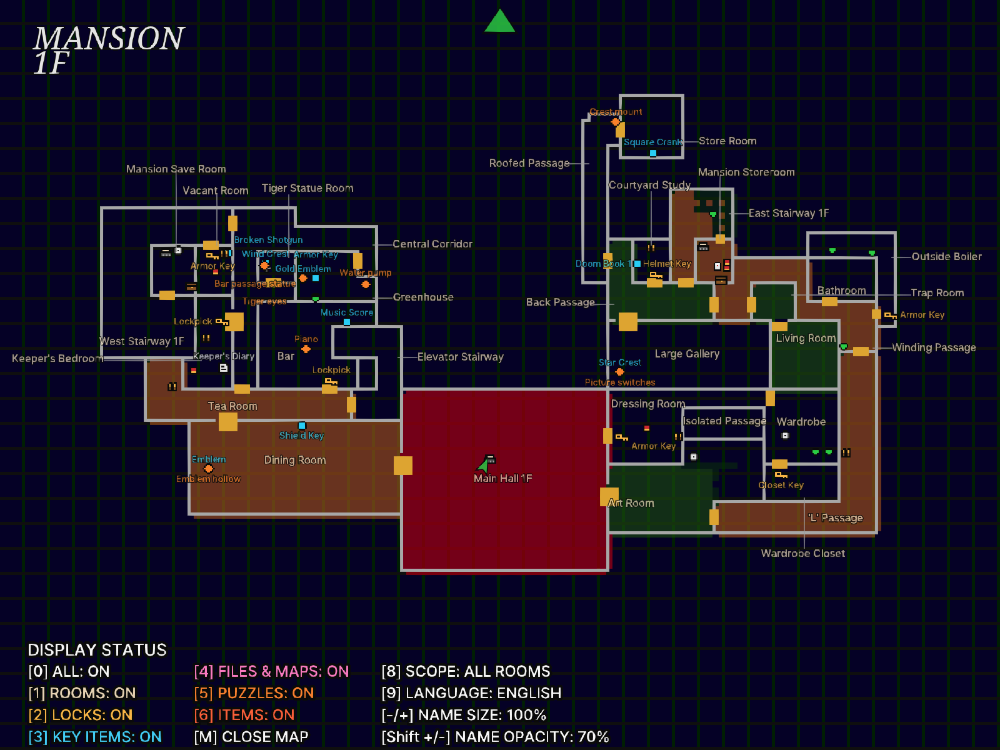
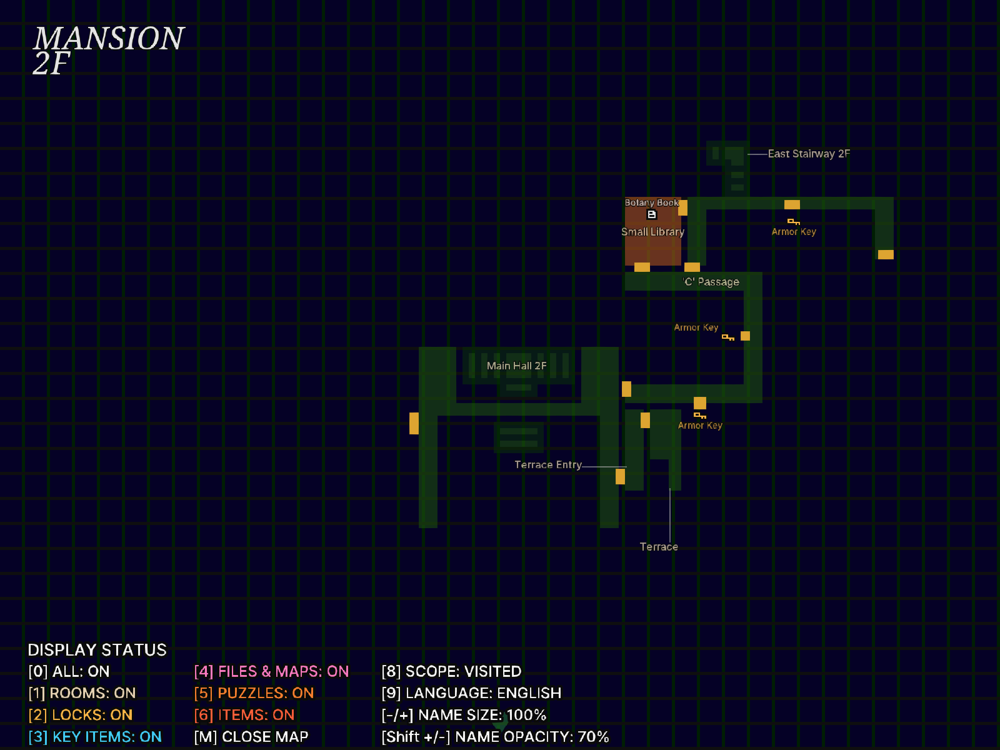
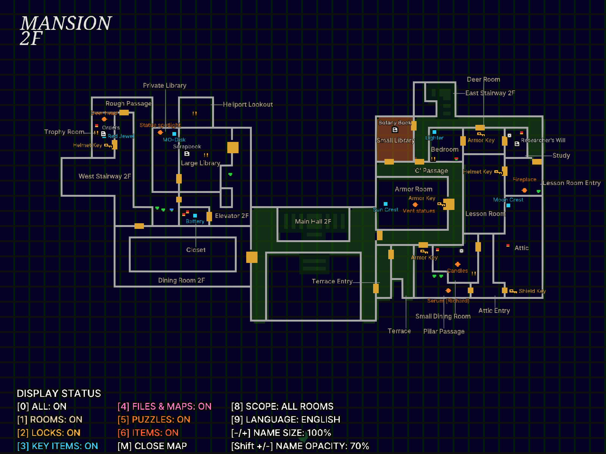
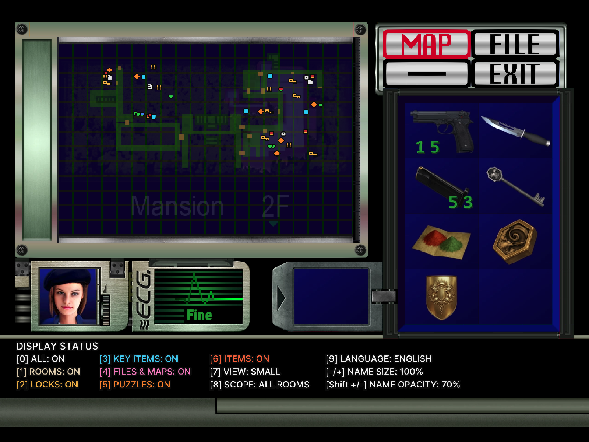

# Annotated Map: Survivor's Notes — Resident Evil (1996)

[English](README.en.md) | 한국어

**상세 지도: 생존자의 메모** — 원작 Resident Evil PC판(GOG 일본어판 `Biohazard.exe` + [Classic REbirth 1.1.4](https://classicrebirth.com/index.php/re1cb-changelog/))의 지도에 방 이름, 잠긴 문과 필요한 열쇠, 핵심 아이템, 문서·지도, 퍼즐, 일반 아이템, 타자기·아이템 상자를 표시하는 ASI 모드입니다. 한국어/영어를 지원합니다.

- 상태 화면 지도에는 아이콘만, **Tab**(패드 **START**)으로 여는 전체 화면 지도에는 이름까지 표시합니다.
- 주운 아이템, 연 문, 푼 퍼즐은 지도에서 사라집니다. 아이템이 남은 방은 호박색으로 칠합니다.
- 잠긴 문의 열쇠는 아직 가지 않은 쪽 방에 표시합니다. 전체 화면 지도에는 현재 위치와 바라보는 방향을 화살표로 표시합니다.
- 크리스/질의 아이템 배치 차이를 반영합니다.

## 스크린샷

### 전체 화면 지도

| | 방문한 방 | 모든 방 |
|---|---|---|
| 저택 1층 |  |  |
| 저택 2층 |  |  |

### 상태 화면 지도

| | 방문한 방 | 모든 방 |
|---|---|---|
| 저택 2층 |  |  |

## 설치

1. [Releases](https://github.com/eggu/resident-evil-annotated-map/releases)에서 `RE1-Annotated-Map-<버전>.zip`을 받습니다. `Source code`는 설치 파일이 아닙니다.
2. 게임을 종료하고 ZIP의 내용(`dsound.dll`, `scripts/`)을 `Biohazard.exe`가 있는 게임 폴더에 폴더 구조 그대로 복사합니다. REbirth **MOD SELECTION**에서 체크할 필요는 없습니다.
3. Classic REbirth는 별도로 설치해야 합니다. ASI 로더인 [Ultimate ASI Loader](https://github.com/ThirteenAG/Ultimate-ASI-Loader) v9.7.4(MIT)가 `dsound.dll`로 포함되어 있습니다.
   - REuncap 등으로 Ultimate ASI Loader가 이미 `dsound.dll`로 설치되어 있으면 `dsound.dll`은 건너뛰어도 됩니다.
   - ASI 로더가 아닌 다른 `dsound.dll`(예: DSOAL)이 있으면 덮어쓰지 말고, 포함된 `dsound.dll`을 `winmm.dll` 이름으로 복사하세요.

1.1.0에서 업그레이드: 게임 폴더의 `RE1.AnnotatedMap.dll`과 `mod_annotated_map/`을 지웁니다. 기존 설정을 유지하려면 `mod_annotated_map/RE1.AnnotatedMap.ini`를 `scripts/`로 옮겨 기본 INI 대신 사용하세요. 이후 업그레이드에서는 `scripts/RE1.AnnotatedMap.ini`를 건너뛰거나 백업 후 복원하세요.

제거: `scripts/RE1.AnnotatedMap.asi`, `.ini`, `.log`를 지웁니다. 다른 ASI 모드가 없으면 `dsound.dll`도 지웁니다. EXE와 세이브는 수정하지 않습니다. 지원 대상이 아닌 `Biohazard.exe`(타임스탬프 `0x3642d468`이 아닌 경우)에서는 아무것도 패치하지 않습니다.

[한글 HD 번역 모드](https://github.com/eggu/resident-evil-korean-hd-translation)와 함께 사용할 수 있습니다.

## 단축키

| 키 | 동작 |
|---|---|
| Tab / 패드 START(Menu/Options) | 전체 화면 지도 열기·닫기 (탐색 중 조작 가능한 상태 또는 상태창 지도에서) |
| Esc / 취소 버튼 | 전체 화면 지도 닫기 |
| 앞/뒤 이동 | 층 선택 |
| 좌/우 이동 | 장소 선택 |
| 0 | 전체 표시 켜기/끄기 |
| 1 | 방 이름·타자기·아이템 상자 |
| 2 | 잠긴 문·열쇠 |
| 3 | 핵심 아이템 (+ 아이템이 남은 방 호박색) |
| 4 | 문서·지도 |
| 5 | 퍼즐 |
| 6 | 일반 아이템 |
| 8 | 표시 범위: 방문한 방 → 공개된 방(층 지도 획득) → 모든 방 |
| 9 | 한국어 / English |
| - / = (+), 숫자패드 - / + | 이름 크기 10%씩 (50–150%) |
| Shift + 위 키 | 이름 불투명도 10%씩 (10–100%) |

## 설정 (`scripts/RE1.AnnotatedMap.ini`)

배포 ZIP에 설명 주석이 담긴 기본 설정 파일을 포함합니다. 편집 전 게임을 종료하고, 저장 후 게임을 다시 실행하세요.

### 패드 지도 버튼 변경

START를 게임 동작에 연결해 두었다면 `[Keys]`의 `OpenPad=START`를 사용하지 않는 버튼으로 바꾸세요. Classic REbirth는 기본으로 BACK에 설정 화면을 둡니다. 예를 들어 왼쪽 스틱 클릭은 다음과 같습니다.

```ini
[Keys]
OpenPad=LS
```

지원 버튼은 아래 표에 있습니다. LT/RT 트리거와 버튼 조합은 지원하지 않으며, 게임 자체의 패드 설정과 별도로 동작합니다. `OpenPad=NONE`으로 설정하면 패드 지도 단축키를 끄고 키보드 `OpenKey=TAB`으로 사용할 수 있습니다. 이 설정은 기존 1.1.0에서도 사용할 수 있습니다. INI에 `[Keys]`가 없다면 위 예시를 추가하고, 저장한 뒤 재실행하세요.

### 표시·키 설정

표시 옵션과 이름 크기·불투명도를 저장합니다. 기본값은 **영어, 이름 100%, 불투명도 70%, 방 표시만 켬**입니다. `All`은 방 표시를 위한 전체 스위치로 켜집니다. 업그레이드할 때 기존 INI를 보존해야 사용자 설정을 유지할 수 있습니다. 일반 키보드에서는 Shift 없이 `= (+)` 키로 크기를 키우세요.

범례는 Pretendard Medium(4배 제작 기준 본문20px·제목22px·테두리3px), 작은 지도도 같은 문구와 상태를 표시합니다. 작은 지도 범례는 HUD 아래 검은 여백에 배치합니다.

| 항목 | 기본값 | 설명 |
|---|---|---|
| `[Keys] OpenKey` | `TAB` | 키보드로 열기·닫기. 한 글자, `ESC`, `TAB`, `SPACE`, `F1`–`F12`, `0x4D` 같은 가상 키 코드, `NONE` |
| `[Keys] OpenPad` | `START` | 패드로 열기·닫기(XInput). `A B X Y LB RB START BACK LS RS UP DOWN LEFT RIGHT`, `NONE` |
| `[Keys] CloseKey` | `ESC` | 키보드로 닫기 |
| `[Keys] CloseOnCancel` | `1` | 게임의 취소 버튼으로 닫기 |
| `[AnnotatedMap] RoomTint` | `1` | `0`이면 아이템이 남은 방 색칠 끄기 |
| `[AnnotatedMap] NameSize` | `100` | 이름 크기(50–150), 기존 크기가100 |
| `[AnnotatedMap] NameOpacity` | `70` | 이름 불투명도(10–100) |
| `[Calibration] OffsetX/OffsetY/Z` | | 상태창 지도 표시 위치·깊이 보정 |
| `[Calibration] ArrowRotation` | `0` | 캐릭터 화살표 방향 보정(도) |

릴리스 변경 사항과 검증 상태: [한글·영문 릴리스 노트](RELEASE_NOTES.md).


확대된 이름은 기존 위치를 유지하므로 겹칠 수 있습니다. 실제 게임의 새 HUD 배치·키 입력·GPU 알파·장시간 사용은 아직 검증하지 않았습니다.

## 빌드


```sh
python3 -m venv .venv && .venv/bin/pip install -r requirements.txt
export RE1_GAME_DIR="/path/to/Resident Evil"   # Biohazard.exe와 jpn/이 있는 GOG 일본어판 폴더
.venv/bin/python build.py --package           # 위키 → 에셋 → DLL → 네이티브 테스트 → dist/ ZIP
```

글꼴 옵션을 생략하면 포함된 오픈소스 글꼴을 사용합니다: 본문 Pretendard, 영문 제목 Noto Serif, 한글 제목 나눔명조. 빌드할 때 각 글꼴을 바꿀 수 있습니다.

```sh
.venv/bin/python build.py --package --font "/path/to/body.ttf" \
  --title-font-en "/path/to/title-en.ttf" --title-font-ko "/path/to/title-ko.ttf"
```

필요한 옵션만 지정하면 나머지는 기본값을 사용합니다. 한글에는 한글 글리프를 포함한 글꼴을 선택하세요. 글꼴은 빌드 시 이미지로 만들어지므로 변경 후 다시 빌드해야 합니다. 잘못된 경로나 읽을 수 없는 글꼴은 빌드를 중단합니다. 사용자 지정 글꼴을 배포할 때는 해당 라이선스를 확인하세요.

- 데이터를 다시 추출하려면 `--extract`를 붙입니다. 이때는 모든 `ROOM*.RDT`와 `refs/evilresource/pages/*.html`([evilresource.com/resident-evil](https://www.evilresource.com/resident-evil) 방 페이지)이 필요합니다. 참고 자료: [RE1-Mod-SDK](https://github.com/Gemini-Loboto3/RE1-Mod-SDK), [biorand/classic](https://github.com/biorand/classic), [biorand/biohazard-utils](https://github.com/biorand/biohazard-utils).
- 손으로 관리하는 데이터는 `data/curated.json`(퍼즐, 이벤트 아이템, 방 이름 보정)과 `data/items.json`(아이템 이름)입니다.
- `tests/test_native.py`는 실제 EXE와 빌드한 DLL을 Unicorn으로 실행해 패치, 플래그 판정, 지도 입력, 그리기 명령을 확인합니다. `tools/audit_fit.py`는 방별 월드→지도 변환을 점검합니다.

조사 자료와 구현 근거는 [위키](docs/wiki/README.md)에 있습니다.

## 라이선스

소스는 [MIT License](LICENSE)입니다. 비공식 팬 모드이며 Capcom 및 Classic REbirth와 관련이 없습니다. 참고 자료와 글꼴 라이선스는 [NOTICE](NOTICE.md)에 있습니다.
